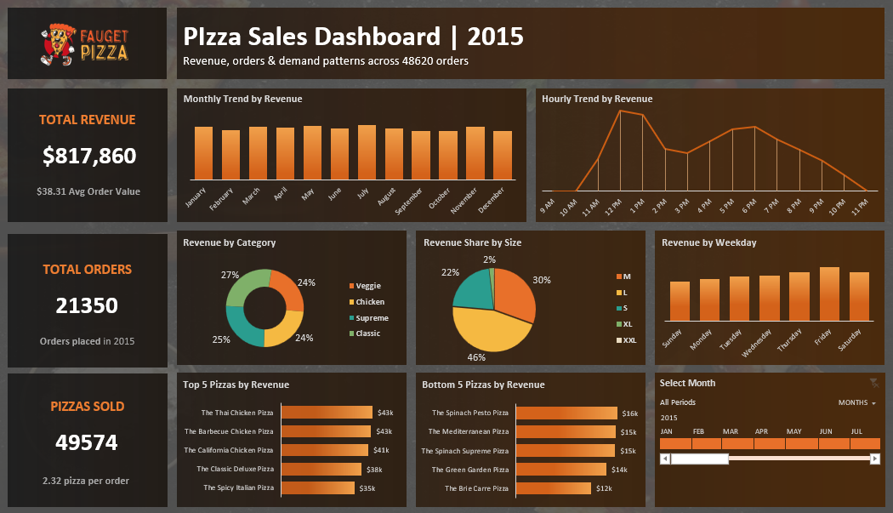

# 🍕 Fauget Pizza: Sales Performance Dashboard 2015

**End-to-end sales analysis of 48,620 pizza order lines (2015), using Excel (pivot tables, pivot charts, timeline), data validation checks and SQL Server to find when the shop sells most, which pizzas and sizes earn the most, and how steady revenue is through the year.**

📊 [View Dashboard Screenshot](https://github.com/SahilBhowad/fauget-pizza-sales-dashboard/blob/main/images/dashboard.png) | 🗄️ [View SQL Queries](https://github.com/SahilBhowad/fauget-pizza-sales-dashboard/blob/main/sql/pizza_sales_analysis.sql) | 📥 [Download Excel File](https://github.com/SahilBhowad/fauget-pizza-sales-dashboard/tree/main/dashboard) | 🧾 48,620 Order Lines Analyzed

---

## 📌 The Business Problem

Imagine you own Fauget Pizza. You have a full year of orders but no clear picture of them. The question:

> **When are we busiest, which pizzas and sizes make the money, and is the business steady through the year?**

**Data:** 1 Jan 2015 to 31 Dec 2015. 48,620 rows (one row per pizza on an order) from 21,350 orders. 12 original columns: `pizza_id`, `order_id`, `pizza_name_id`, `quantity`, `order_date`, `order_time`, `unit_price`, `total_price`, `pizza_size`, `pizza_category`, `pizza_ingredients`, `pizza_name`. I added 3 helper columns in Excel: `order_day`, `order_month`, `new_order`.

Because the data has one row per pizza, counting rows would overcount orders (48,620 rows vs 21,350 orders). I handled this in both Excel and SQL (see SQL Highlight).

---



---

## 💡 Key Results

* Revenue was **$817,860** from **21,350 orders** and **49,574 pizzas**. The average order is **$38.31** with **2.32 pizzas**.
* There are **two daily rush hours**: 12 PM ($111,878) and 6 PM ($89,297).
* **Friday is the strongest day** ($136,074). Sunday is the slowest ($99,204).
* **Large pizzas bring 46% of revenue** ($375,319), far ahead of Medium (30%).
* **The Thai Chicken Pizza is the top seller** (about $43k). The Brie Carre Pizza is the weakest (about $12k).
* **Revenue is steady all year.** Every month sits between $64k and $73k.

These are patterns in one year of sales, not proof of why they happen.

---

## 🛠️ Tools & Approach

| Stage | What I did |
|---|---|
| Data prep | Checked columns and formats, added helper columns (day, month, `new_order`) |
| Analysis | 9 pivot tables: KPIs, monthly, daily and hourly trends, category, size, all 32 pizzas, Top 5 and Bottom 5 |
| Validation | Validation sheet checking row count, blanks, unique pizza IDs, quantity and price. Every check passed |
| Dashboard | KPI cards, 7 pivot charts and a month timeline, all linked to the pivot tables |
| SQL layer | 10 queries on the original file as an independent check. Numbers match the dashboard |

<details>
<summary><b>📋 Full workflow: what I did, step by step (click to expand)</b></summary>

1. **Loaded the data** into Excel and checked the columns and formats.
2. **Added helper columns** for the day name and month name (from the date), plus `new_order`, which marks the first row of each order with a 1 and the others with a 0.
3. **Built the Analysis sheet** with 9 pivot tables: headline KPIs, monthly trend, daily trend, hourly trend, revenue by category, revenue by size, revenue for all 32 pizzas, and Top 5 and Bottom 5 pizzas.
4. **Built the Validation sheet** with checks on row count, blank cells, unique pizza IDs, quantity and price. Every check passed.
5. **Designed the dashboard background** from a food photo, a dark layer on top, and rectangles as placeholders for charts and KPI cards.
6. **Added the KPI cards, 7 charts and one timeline.** Everything is connected to the pivot tables, so if the data changes, the Analysis sheet and the dashboard update too. Clicking a month in the timeline filters the dashboard.
7. **Added the Insights sheet** with a table of findings, evidence and recommendations.
8. **Repeated the numbers in SQL** and compared them with the dashboard.

</details>

**The Excel workbook**

| Sheet | What it does |
|---|---|
| **Dashboard** | The final report: 3 KPI cards, 7 charts, a timeline filter |
| **Insights** | 5 findings, each with evidence and a recommendation |
| **Analysis** | The calculation layer: 9 pivot tables that feed the dashboard |
| **Validation** | Data quality checks (result vs expected) |
| **Data** | The raw data plus the helper columns |

The sheet order tells the story: what happened (Dashboard), what it means (Insights), how it was calculated (Analysis), proof it is clean (Validation), and the source (Data).

---

## 🔎 Findings

| # | Finding | Evidence | Recommendation |
|---|---|---|---|
| 1 | Two daily rush hours | 12 PM and 6 PM have the highest revenue of the day | Prepare dough and add staff before 12 PM and 6 PM |
| 2 | Friday is the strongest day | Friday $136,074 vs Sunday $99,204 | Run offers on slower days like Sunday and Monday |
| 3 | Large size leads | 46% of total revenue comes from Large | Push Large combos and upsell Medium to Large |
| 4 | Top vs bottom pizzas | Thai Chicken $43k vs Brie Carre $12k | Promote top sellers, review the bottom 5 |
| 5 | Steady all year | Monthly revenue stays between $64k and $73k | Plan stock evenly through the year |

The recommendations are ideas from the numbers, not tested actions.

---

## 🗄️ SQL Highlight

I loaded the original source file (no Excel edits) into SQL Server as `pizza_sales` and wrote 10 queries: row count and KPIs, revenue by month, weekday and hour, revenue share by size and category, Top 5 and Bottom 5 pizzas, and the same data quality checks as the Validation sheet. Because SQL did not use my Excel helper columns, it works as an independent check. Each query has a short insight line.

**Orders vs rows:** SQL counts unique orders directly:

```sql
SELECT COUNT(DISTINCT order_id) AS total_orders
FROM pizza_sales;   -- 21,350
```

Excel pivot tables cannot count distinct values without the Data Model, so I used the `new_order` helper column instead. Both give the same answer.

Full file: `sql/pizza_sales_analysis.sql`

---

## 📊 Dashboard Features

* **KPI cards:** Total Revenue, Total Orders, Pizzas Sold, with average order value and pizzas per order underneath
* **Charts:** monthly trend, hourly trend, revenue by category, revenue share by size, revenue by weekday, Top 5 pizzas, Bottom 5 pizzas
* **Timeline:** pick a month and the whole dashboard updates

Tip: click a single month in the timeline to see how the KPIs and charts change, then reset it to All Periods.

---

## ⚠️ Limitations & Next Steps

**Limitations**

* It is **one year** of data from **one shop**, so patterns may not hold for other years or places.
* The data has **revenue only**, with no cost or profit, so "best selling" means most revenue, not most profit.
* The findings show **patterns, not causes**.
* The Insights sheet text is typed, so it describes the full year and does not change with the timeline.

**Next Steps**

* Add cost data to measure profit, not only revenue.
* Test one recommendation (for example a Sunday offer) and measure the result.

---

## 🎓 What I Learned

* How to build a dashboard where pivot tables, charts, KPI cards and the filter all stay connected.
* Why rows are not the same as orders, and how to count unique orders in both Excel and SQL.
* How to link shapes to cells so KPI cards update by themselves.
* How to check my own work: the Validation sheet in Excel and a second check in SQL.
* How to turn numbers into findings with evidence and a recommendation.

---

## 📁 Repo Structure

```
fauget-pizza-sales-dashboard/
├── dashboard/
│   └── Fauget_Pizza_Sales_Dashboard.xlsx
├── data/
│   └── pizza_sales.csv
├── images/
│   ├── sql_result/            (q1.png ... q10.png)
│   └── dashboard.png
├── sql/
│   └── pizza_sales_analysis.sql
├── LICENSE
└── README.md
```

## 🚀 How to Run

1. Download `Fauget_Pizza_Sales_Dashboard.xlsx` and open it in desktop Excel. The timeline and pivot charts need a recent desktop version.
2. Go to the **Dashboard** sheet and click a month in the timeline.
3. To refresh after changing the data: **Data > Refresh All**.
4. **SQL:** import `data/pizza_sales.csv` into SQL Server as `pizza_sales` with the SSMS Import Flat File wizard, then run `pizza_sales_analysis.sql`.
5. If your dates import as text in `dd-mm-yyyy` format, the queries already convert them with `CONVERT(DATE, order_date, 105)`.

The dataset in `data/` belongs to its original publisher. The MIT License covers my code and analysis only.

---

**Sahil Bhowad** | Aspiring Data Analyst | Mumbai | [LinkedIn](https://www.linkedin.com/in/sahil-bhowad-7a915934a/) | [GitHub](https://github.com/SahilBhowad)
